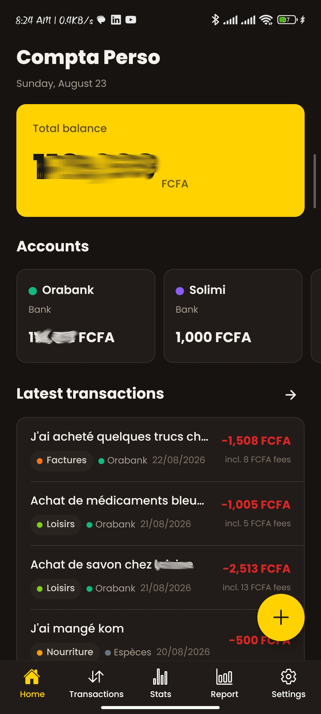
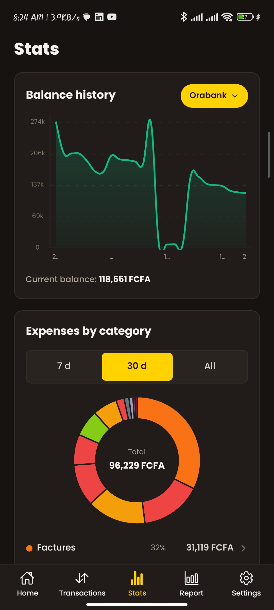
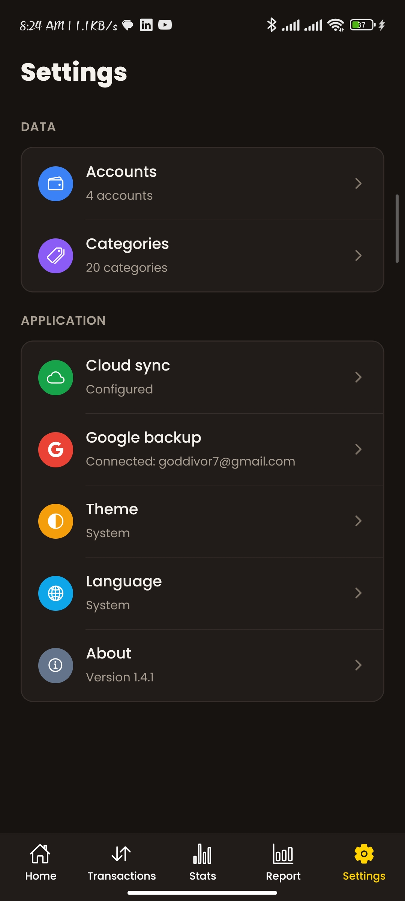

<div align="center">

# compta-perso-mobile

[](https://developer.mozilla.org/docs/Web/JavaScript)
[](https://github.com/goddivor/compta-perso-mobile/releases/latest)
[](./LICENSE)
[](https://github.com/goddivor/compta-perso-mobile/releases)

[](https://www.npmjs.com/package/expo)
[](https://www.npmjs.com/package/react-native)
[](https://www.npmjs.com/package/expo-sqlite)
[](https://www.npmjs.com/package/@react-navigation/native)
[](https://www.npmjs.com/package/react-native-gifted-charts)
[](https://www.npmjs.com/package/@react-native-google-signin/google-signin)

[](https://github.com/goddivor/compta-perso-mobile/stargazers)
[](https://github.com/goddivor/compta-perso-mobile/network/members)
[](https://github.com/goddivor/compta-perso-mobile/watchers)
[](https://github.com/goddivor/compta-perso-mobile/graphs/contributors)
[](https://github.com/goddivor/compta-perso-mobile/issues)

Keep your **personal accounts** in your pocket, entirely **offline**. Accounts,
transactions, transfers, fees, statistics and reports live in a **local SQLite** database on the
phone: no sign-up, no server, nothing leaves the device unless you ask for it.

Backups are yours too: send a snapshot to **your own Google Drive**, or share the same data with the
[desktop app](https://github.com/goddivor/compta-perso-desktop) through the
[sync API](https://github.com/goddivor/compta-perso-server).

<table>
  <tr>
    <td></td>
    <td></td>
    <td></td>
  </tr>
</table>

</div>

## 🎖️ Features

- **Offline first** — every screen works with no network; an account is never required
- **Accounts and balances** — total balance up front, one card per account, tap to filter
- **Transactions** — search, group by day, edit or delete, add from anywhere with the floating button
- **Transfers between accounts** — both entries written and paired in one step, fees included
- **Fee rules per account** — a rate saved once, applied to a transaction with a single switch
- **Advanced filters** — several accounts and categories at a time, include or exclude mode, uncategorised filter, precise date ranges
- **Quick filter** — long press the filter button, slide to an account bubble, release
- **Statistics** — balance history, expenses by category with tap-through to the matching transactions, monthly money in and out
- **Report and graph** — daily totals, plus a chronological graph with one column per account
- **Google Drive backup** — sign in with Google, snapshots go to the private app folder of your own Drive, manually or on a schedule
- **Cloud sync** — optional shared snapshot with the desktop app, configured in one tap
- **In-app updates** — new versions are detected, downloaded and installed without leaving the app
- **Bilingual and themed** — French and English, light and dark, both following the system by default

## 📋 Requirements

- Android 7.0 or newer to install the APK
- Node.js >= 20, the Android SDK and JDK 17 to build from source
- A Google account only if you want Drive backups

## 📦 Installation

Download the APK from the [releases page](https://github.com/goddivor/compta-perso-mobile/releases/latest)
and open it on the phone. Android asks once for permission to install applications from this source.

From a clone:

```bash
npm install
npx expo start
```

## ⚙️ Usage

```bash
# Development server, then open the project in Expo Go
npx expo start

# Build and run the native debug app on a connected device
npx expo run:android

# Signed release APK
cd android && ./gradlew assembleRelease
```

### 🔐 Environment

Two optional keys, both read at build time from a gitignored `.env`:

```bash
# Sync API configuration key (fetches the URL and the token)
EXPO_PUBLIC_CONFIG_KEY=...

# Google OAuth web client ID, for Drive backups
EXPO_PUBLIC_GOOGLE_WEB_CLIENT_ID=...apps.googleusercontent.com
```

Without them the app still runs; only cloud sync and Google backup report that they are not configured.

### ☁️ Backups and sync

| Feature | Where the data goes | Set up |
|---|---|---|
| Google backup | The private app folder of your own Drive | Settings, Google backup, sign in |
| Cloud sync | The shared MongoDB snapshot behind the sync API | Settings, Cloud sync, fetch configuration |

Both are optional and independent; the local database stays the source of truth.

### 🔄 Updates

The app checks the GitHub releases at launch. When a version is available it offers the release
notes, downloads the APK inside the app with a progress bar, then hands it to the Android installer.
The same check is available by hand in Settings, About.

## 🤝 Contributing

Contributions of all kinds are welcome: bug reports, feature ideas and pull requests. Open an
[issue](https://github.com/goddivor/compta-perso-mobile/issues) first for anything substantial, and
make sure `npx expo export --platform android` passes before every commit.

## 📜 License

Licensed under MIT License and copyrights reserved.
